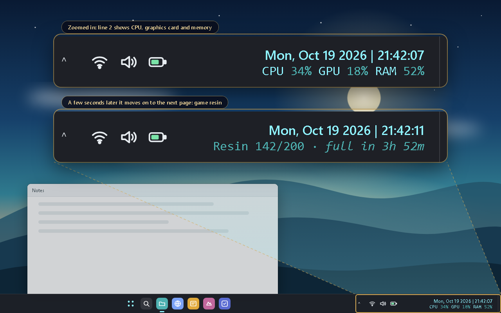

# Custom Clock

A two-line Windows 11 taskbar clock. Line 1 is the date and time (with seconds); line 2 cycles through media, CPU / GPU / RAM and Genshin resin.



*The screenshot is a mock-up with made-up numbers.*

## How it works

- `feeder.py` collects the values (using the collectors in `main.py`) and writes them to `%APPDATA%\CustomClock\data.txt` once a second.
- `windhawk-mod/custom-clock-line2.wh.cpp` is a [Windhawk](https://windhawk.net) mod. It reads `data.txt` and draws both lines inside the real taskbar clock.
- Looks (colours, fonts, pages, timing, tags for mixed styles) are all settings in the mod's Settings tab in Windhawk.
- `main.py` also still runs on its own as a small floating widget: `python main.py`.
- `ditto-theme/` holds a matching teal theme for the Ditto clipboard manager (optional).

## Requirements

- Windows 11 with [Windhawk](https://windhawk.net) installed.
- Python 3 for the feeder.
- Python packages from `requirements.txt`: `psutil`, `genshin` and the `winrt-*` packages (for the currently playing media).

## Setup

1. Make an environment and install the packages:
   ```
   python -m venv .venv
   .venv\Scripts\pip install -r requirements.txt
   ```
2. In Windhawk, create a new mod, paste in `windhawk-mod/custom-clock-line2.wh.cpp`, compile and enable it, then restart Explorer.
3. Start the feeder: `.venv\Scripts\pythonw.exe feeder.py` (use `python.exe` to see errors). It does not start with Windows by itself.
4. Optional, for the resin page: create `%APPDATA%\CustomClock\cookies.json` with your own HoYoLAB login values (`ltuid_v2`, `ltoken_v2`, `ltmid_v2`). Without it, the resin page just says there are no cookies.

## Please read

- **The Windhawk mod can break after a Windows update.** It hooks an internal Windows taskbar function that Microsoft can change at any time. If the clock looks wrong after an update, disable the mod in Windhawk. Nothing in Windows itself is changed, and disabling the mod brings back the normal clock.
- **Your HoYoLAB cookie is a login.** It is read only from `%APPDATA%\CustomClock\cookies.json` on your own PC and is used only to ask HoYoLAB for your resin. It is never stored in this project folder (`.gitignore` blocks `cookies.json`) and never sent anywhere else. Never share it.
- **The `genshin` Python package is licensed GPL-3.** It is not included in this repository; it is installed separately from PyPI by `pip install -r requirements.txt`. Check its licence if you plan to redistribute anything that bundles it.
- Nothing opens a network port. Only the resin lookup talks to the internet (to HoYoLAB).

Unofficial fan-made project, not affiliated with or endorsed by HoYoverse.

## Licence

MIT, see [LICENSE](LICENSE).

More projects: https://github.com/Shamilimanuel
